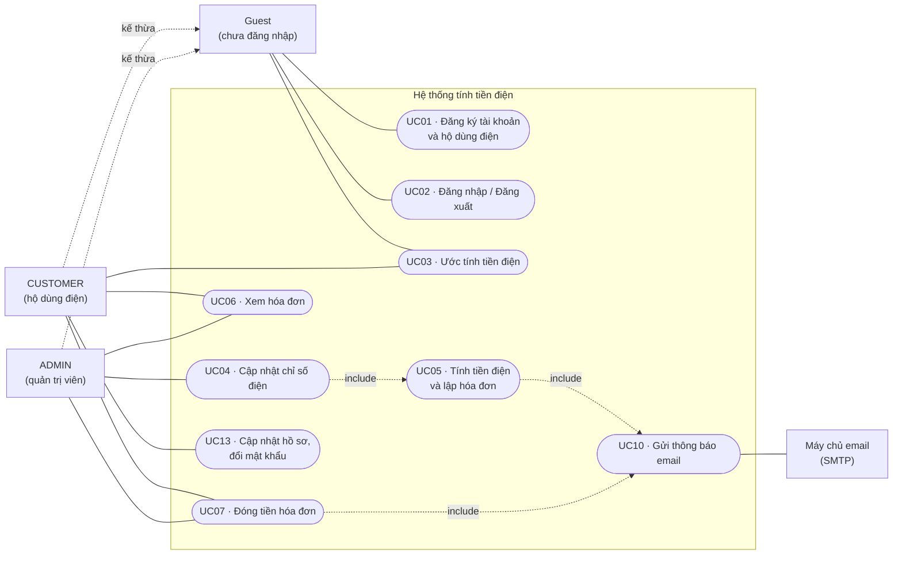
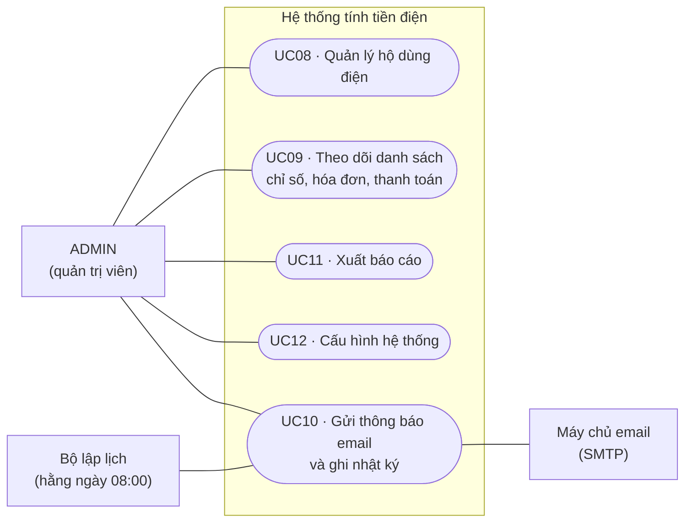

# TÀI LIỆU ĐẶC TẢ YÊU CẦU PHẦN MỀM
**(Software Requirement Specification – SRS)**

## Hệ thống tính tiền điện cho hộ cá nhân

| | |
|---|---|
| Phiên bản | 1.0.0 |
| Nhóm sinh viên | *<điền tên các thành viên>* |
| Ngày tạo | 09/10/2026 |

---

## Mục lục

1. Phạm vi
   1.1 Mục đích · 1.2 Nhận diện · 1.3 Kiến trúc hệ thống · 1.4 Thuật ngữ và từ viết tắt
2. Các yêu cầu chức năng
   2.1 Mô tả hệ thống · 2.2 Các chức năng của hệ thống · 2.3 Đặc tả use-case · 2.4 Quy tắc nghiệp vụ và cách tính tiền · 2.5 Dữ liệu · 2.6 Màn hình và phân quyền
3. Yêu cầu về hiệu năng
4. Các yêu cầu phi chức năng khác
   4.1 Bảo mật · 4.2 Khả năng sử dụng · 4.3 Độ tin cậy và toàn vẹn dữ liệu · 4.4 Tương thích · 4.5 Bảo trì và kiểm thử

---

## 1. Phạm vi

### 1.1 Mục đích

Tài liệu này mô tả các yêu cầu của **Hệ thống tính tiền điện cho hộ cá nhân** (sau đây gọi là *Hệ thống*): Hệ thống làm gì, cho ai, theo quy tắc nào và phải đạt mức chất lượng nào.

Tài liệu được dùng để:

- thống nhất phạm vi và yêu cầu giữa đơn vị điện lực và nhóm phát triển;
- làm căn cứ thiết kế, lập trình và bảo trì phần mềm;
- làm căn cứ lập kế hoạch kiểm thử, viết ca kiểm thử và nghiệm thu.

Người đọc là đại diện đơn vị điện lực, nhóm phát triển và nhóm kiểm thử. Mỗi yêu cầu có một mã riêng (FR, UC, BR, NFR) để tham chiếu trong thiết kế và kiểm thử.

### 1.2 Nhận diện

| Mục | Nội dung |
|---|---|
| Tên hệ thống | Hệ thống tính tiền điện cho hộ cá nhân (Electric Billing) |
| Phiên bản | 1.0.0 |
| Loại phần mềm | Ứng dụng web, người dùng truy cập bằng trình duyệt |
| Người dùng | Hộ dùng điện (khách hàng) và quản trị viên của đơn vị điện lực |
| Chức năng chính | Đăng ký hộ dùng điện, ghi chỉ số điện, tính tiền điện, đóng tiền<br>Thông báo qua email, theo dõi danh sách, xuất báo cáo, cấu hình |

**Trong phạm vi**

- Điện sinh hoạt của hộ cá nhân; mỗi hộ có một công tơ và một tài khoản.
- Hóa đơn theo tháng, tính theo biểu giá bậc thang và thuế VAT.
- Thanh toán đủ một lần cho mỗi hóa đơn: trực tuyến ở mức mô phỏng, hoặc tiền mặt tại quầy.
- Thông báo qua email; báo cáo trên màn hình và tệp CSV.

**Ngoài phạm vi**

- Kết nối cổng thanh toán thật.
- Đọc chỉ số tự động từ công tơ thông minh.
- Điện kinh doanh, sản xuất; nhiều hộ dùng chung một công tơ.
- Thanh toán một phần, phí chậm trả, công tơ quay vòng số.
- Ứng dụng di động riêng.

### 1.3 Kiến trúc hệ thống

Hệ thống là một ứng dụng web nguyên khối: máy chủ xử lý nghiệp vụ và sinh trang HTML, trình duyệt chỉ hiển thị.

**Nền tảng xây dựng**

| Thành phần | Công nghệ |
|---|---|
| Ngôn ngữ | Java 21 |
| Khung ứng dụng | Spring Boot 4.1.1 (Spring MVC, Spring Data JPA, Spring Security, Spring Mail, tác vụ định kỳ) |
| Giao diện | Thymeleaf và Bootstrap 5; tệp CSS nằm trong ứng dụng nên chạy được khi không có Internet |
| Cơ sở dữ liệu | MySQL 8, mã hóa utf8mb4; H2 trong bộ nhớ cho chế độ chạy thử |
| Email | Gửi qua máy chủ SMTP |
| Đóng gói | Maven (Maven Wrapper) |

**Nền tảng chạy:** máy chủ hoặc máy tính cá nhân chạy Windows hoặc Linux, có JDK 21 và MySQL 8. Người dùng truy cập bằng Chrome hoặc Firefox bản mới nhất qua cổng mặc định `8080`.

**Các lớp của ứng dụng**

```
 Trình duyệt ──HTTP──▶ Controller (Spring MVC + Thymeleaf)
                          │
                          ▼
                       Service  ◀── BillingCalculator (tính tiền, thuần logic)
                          │            MailService ──SMTP──▶ Máy chủ email
                          ▼            ReminderScheduler (tác vụ định kỳ)
                      Repository (Spring Data JPA)
                          │
                          ▼
                       MySQL
```

| Lớp | Gói mã nguồn | Trách nhiệm |
|---|---|---|
| Giao diện | `web`, `dto` | Nhận yêu cầu từ trình duyệt, kiểm tra dữ liệu nhập, trả về trang HTML hoặc tệp CSV |
| Nghiệp vụ | `service`, `scheduler` | Đăng ký, ghi chỉ số, tính tiền, lập hóa đơn, thanh toán, thông báo, báo cáo, cấu hình; tác vụ nhắc nợ hằng ngày |
| Dữ liệu | `repository`, `domain` | Thực thể và truy vấn cơ sở dữ liệu |
| Hạ tầng | `config`, `exception` | Xác thực và phân quyền, khởi tạo dữ liệu ban đầu, lỗi nghiệp vụ |

Phần tính tiền điện là một thành phần riêng, không phụ thuộc cơ sở dữ liệu, để có thể kiểm thử độc lập.

### 1.4 Thuật ngữ và từ viết tắt

| Thuật ngữ | Giải thích |
|---|---|
| Hộ dùng điện (khách hàng) | Hộ cá nhân dùng điện sinh hoạt, có một công tơ và một tài khoản trên Hệ thống |
| Quản trị viên | Nhân viên đơn vị điện lực vận hành Hệ thống |
| Chỉ số điện | Số đọc trên công tơ, tính bằng kWh, là số nguyên |
| Kỳ | Tháng và năm của hóa đơn, ví dụ 09/2026 |
| Điện năng tiêu thụ | Chỉ số mới trừ chỉ số cũ của một kỳ |
| Biểu giá bậc thang | Bảng đơn giá lũy tiến: mỗi khoảng kWh có một đơn giá |
| VAT | Thuế giá trị gia tăng, tính trên tiền điện trước thuế |
| Quá hạn | Hóa đơn chưa thanh toán và đã qua hạn thanh toán |
| FR / UC / BR / NFR | Yêu cầu chức năng / Use-case / Quy tắc nghiệp vụ / Yêu cầu phi chức năng |
| SMTP / CSV | Giao thức gửi email / Định dạng tệp bảng dạng văn bản |

---

## 2. Các yêu cầu chức năng

### 2.1 Mô tả hệ thống

Đơn vị điện lực cần tính tiền điện hằng tháng cho các hộ cá nhân, phát hành hóa đơn, thu tiền và nhắc các hộ chưa đóng. Hệ thống thay cho việc tính tay và ghi sổ: quản trị viên chỉ nhập chỉ số công tơ, Hệ thống tự tính tiền, lập hóa đơn và gửi email; hộ dùng điện tự xem và đóng hóa đơn trên web.

**Người dùng và hệ thống liên quan**

| Tác nhân | Vai trò |
|---|---|
| Khách vãng lai (Guest) | Người chưa đăng nhập. Được đăng ký tài khoản, đăng nhập và ước tính tiền điện |
| Khách hàng (CUSTOMER) | Hộ dùng điện đã đăng nhập. Xem và đóng hóa đơn của mình, cập nhật hồ sơ, đổi mật khẩu |
| Quản trị viên (ADMIN) | Ghi chỉ số, thu tiền tại quầy, quản lý hộ, theo dõi danh sách, gửi thông báo, xem báo cáo, cấu hình |
| Bộ lập lịch | Thành phần của Hệ thống, chạy mỗi ngày lúc 08:00 để gửi email nhắc nợ |
| Máy chủ email | Hệ thống bên ngoài, nhận email từ Hệ thống qua SMTP và chuyển tới hộ dùng điện |

**Quy trình một kỳ tiền điện**

1. Hộ dùng điện đăng ký tài khoản, khai số công tơ và chỉ số ban đầu.
2. Cuối kỳ, quản trị viên nhập chỉ số mới của từng hộ.
3. Hệ thống tính điện năng tiêu thụ, tính tiền theo biểu giá bậc thang và VAT, rồi lập hóa đơn có hạn thanh toán.
4. Hệ thống gửi email báo hóa đơn mới cho hộ.
5. Hộ đóng tiền trực tuyến, hoặc đóng tiền mặt tại quầy và quản trị viên ghi nhận. Hệ thống gửi email xác nhận.
6. Với hóa đơn chưa đóng, Hệ thống gửi email nhắc trước hạn và email báo quá hạn.
7. Quản trị viên theo dõi các danh sách, xem báo cáo và điều chỉnh cấu hình khi cần.

**Giả định và ràng buộc**

- Mỗi hộ có đúng một tài khoản và một công tơ.
- Chỉ số điện là số nguyên không âm và không giảm; Hệ thống không xử lý công tơ quay vòng số.
- Tiền tính bằng đồng Việt Nam, làm tròn đến đồng.
- Biểu giá và VAT cài sẵn chỉ là giá trị khởi tạo; quản trị viên chỉnh lại trong phần Cấu hình.
- Hệ thống tạo sẵn một tài khoản quản trị viên khi khởi động lần đầu. Tài khoản quản trị viên không tạo được qua trang đăng ký.

### 2.2 Các chức năng của hệ thống

Các chức năng chia thành hai nhóm. Cột "Use-case" trỏ tới phần đặc tả chi tiết ở mục 2.3.

**Nhóm 1 – Nghiệp vụ tiền điện: đăng ký, cập nhật số điện, tính tiền, đóng tiền**

| Mã | Chức năng | Use-case | Người dùng | Ưu tiên |
|---|---|---|---|---|
| FR01 | Đăng ký tài khoản và hộ dùng điện | UC01 | Khách vãng lai | Cao |
| FR02 | Đăng nhập, đăng xuất, phân quyền theo vai trò | UC02 | Mọi người dùng | Cao |
| FR03 | Ước tính tiền điện theo số kWh | UC03 | Mọi người dùng | Trung bình |
| FR04 | Ghi chỉ số điện hằng kỳ | UC04 | Quản trị viên | Cao |
| FR05 | Sửa chỉ số của kỳ gần nhất khi hóa đơn chưa thanh toán | UC04 | Quản trị viên | Trung bình |
| FR06 | Tự động tính tiền điện và lập hóa đơn | UC05 | Hệ thống | Cao |
| FR07 | Xem danh sách và chi tiết hóa đơn của hộ | UC06 | Khách hàng | Cao |
| FR08 | Đóng tiền hóa đơn trực tuyến (mô phỏng) | UC07 | Khách hàng | Cao |
| FR09 | Ghi nhận thu tiền mặt tại quầy | UC07 | Quản trị viên | Cao |
| FR10 | Cập nhật hồ sơ và đổi mật khẩu | UC13 | Khách hàng | Trung bình |

**Nhóm 2 – Vận hành và quản trị: thông báo email, theo dõi danh sách, xuất báo cáo, cấu hình**

| Mã | Chức năng | Use-case | Người dùng | Ưu tiên |
|---|---|---|---|---|
| FR11 | Gửi email khi có hóa đơn mới | UC10 | Hệ thống | Cao |
| FR12 | Gửi email nhắc thanh toán trước hạn và báo quá hạn, tự động và thủ công | UC10 | Hệ thống, Quản trị viên | Cao |
| FR13 | Gửi email xác nhận thanh toán | UC10 | Hệ thống | Trung bình |
| FR14 | Ghi nhật ký thông báo và gửi lại thông báo chưa thành công | UC10 | Quản trị viên | Trung bình |
| FR15 | Quản lý hộ dùng điện: tra cứu, xem, sửa, khóa, mở khóa | UC08 | Quản trị viên | Cao |
| FR16 | Theo dõi danh sách chỉ số, hóa đơn, thanh toán có tìm kiếm, lọc, phân trang | UC09 | Quản trị viên | Cao |
| FR17 | Bảng tổng quan số liệu | UC09 | Quản trị viên | Thấp |
| FR18 | Báo cáo doanh thu, danh sách nợ, tiêu thụ theo hộ; xuất CSV | UC11 | Quản trị viên | Cao |
| FR19 | Cấu hình biểu giá bậc thang | UC12 | Quản trị viên | Cao |
| FR20 | Cấu hình VAT, hạn thanh toán, nhắc nợ, email | UC12 | Quản trị viên | Cao |

### 2.3 Đặc tả use-case

Hệ thống có 13 use-case. Hai biểu đồ dưới đây cho biết ai dùng use-case nào; các mục tiếp theo đặc tả từng use-case theo cùng một khuôn: bảng tóm tắt, luồng chính, luồng thay thế và ngoại lệ.

**Biểu đồ use-case – nghiệp vụ tiền điện**



**Biểu đồ use-case – vận hành và quản trị**



Trên biểu đồ, nét liền nối tác nhân với use-case, nét đứt là quan hệ «include», mũi tên tam giác rỗng cho biết khách hàng và quản trị viên vẫn dùng được các chức năng của khách vãng lai. Mọi use-case trừ UC01, UC02 và UC03 đều yêu cầu đăng nhập; quan hệ này không vẽ để hình dễ đọc.

**Quan hệ giữa các use-case**

| Quan hệ | Use-case | Ý nghĩa |
|---|---|---|
| «include» | UC04 → UC05 | Ghi chỉ số hợp lệ luôn kéo theo tính tiền và lập hóa đơn |
| «include» | UC05 → UC10 | Lập hóa đơn xong luôn gửi email báo hóa đơn mới |
| «include» | UC07 → UC10 | Thanh toán thành công luôn gửi email xác nhận |

#### 2.3.1 UC01 – Đăng ký tài khoản và hộ dùng điện

| Mục | Nội dung |
|---|---|
| Tác nhân | Khách vãng lai |
| Mục tiêu | Hộ dùng điện tự tạo tài khoản và khai thông tin hộ, công tơ |
| Tiền điều kiện | Không có |
| Kết quả | Có tài khoản khách hàng và hồ sơ hộ ở trạng thái hoạt động, kèm mã hộ |
| Yêu cầu liên quan | FR01; BR-01, BR-02 |

**Luồng chính**

1. Khách vãng lai mở trang Đăng ký.
2. Khách nhập thông tin tài khoản, thông tin hộ và công tơ, rồi bấm *Đăng ký*.
3. Hệ thống kiểm tra từng trường và kiểm tra trùng tên đăng nhập, email, số công tơ.
4. Hệ thống tạo tài khoản khách hàng với mật khẩu đã băm, tạo hồ sơ hộ và cấp mã hộ.
5. Hệ thống chuyển sang trang Đăng nhập kèm thông báo "Đăng ký thành công. Vui lòng đăng nhập."

**Ngoại lệ**

- Trường bỏ trống hoặc sai định dạng: Hệ thống báo lỗi ngay tại trường đó và giữ lại dữ liệu đã nhập, trừ mật khẩu.
- Mật khẩu xác nhận khác mật khẩu: báo "Mật khẩu xác nhận không khớp".
- Trùng dữ liệu: báo "Tên đăng nhập đã tồn tại", "Email đã được sử dụng" hoặc "Số công tơ đã được đăng ký".

**Dữ liệu nhập** (mọi trường đều bắt buộc)

| Trường | Quy tắc |
|---|---|
| Tên đăng nhập | 4–30 ký tự, chỉ gồm chữ không dấu, số, dấu `_` và dấu `.`; duy nhất |
| Mật khẩu | Từ 8 ký tự, có ít nhất một chữ và một số |
| Xác nhận mật khẩu | Trùng với mật khẩu |
| Họ tên | 2–100 ký tự |
| Địa chỉ | Tối đa 255 ký tự |
| Số điện thoại | 10 chữ số, bắt đầu bằng 0 |
| Email | Đúng định dạng email, tối đa 100 ký tự; duy nhất |
| Số công tơ | 6–15 ký tự chữ hoặc số; duy nhất |
| Chỉ số ban đầu (kWh) | Số nguyên từ 0 đến 9.999.999 |

#### 2.3.2 UC02 – Đăng nhập và đăng xuất

| Mục | Nội dung |
|---|---|
| Tác nhân | Khách vãng lai, Khách hàng, Quản trị viên |
| Mục tiêu | Xác định người dùng và vai trò để mở đúng chức năng |
| Tiền điều kiện | Tài khoản đã tồn tại và không bị khóa |
| Kết quả | Có phiên làm việc; phiên tự hết hạn sau 30 phút không thao tác |
| Yêu cầu liên quan | FR02; BR-15 |

**Luồng chính**

1. Người dùng mở trang Đăng nhập, nhập tên đăng nhập và mật khẩu.
2. Hệ thống xác thực. Tên đăng nhập không phân biệt chữ hoa, chữ thường.
3. Hệ thống chuyển khách hàng tới trang Hóa đơn của tôi, chuyển quản trị viên tới trang Tổng quan.
4. Khi bấm *Đăng xuất*, Hệ thống hủy phiên và trở về trang Đăng nhập với thông báo "Bạn đã đăng xuất".

**Ngoại lệ**

- Sai tên đăng nhập hoặc mật khẩu: báo "Tên đăng nhập hoặc mật khẩu không đúng", không cho biết sai ở trường nào.
- Tài khoản của hộ đang bị khóa: báo "Tài khoản đã bị khóa".
- Chưa đăng nhập mà mở trang cần quyền: Hệ thống chuyển về trang Đăng nhập.
- Đã đăng nhập nhưng mở trang của vai trò khác: Hệ thống hiện trang "403 – Không có quyền truy cập".

#### 2.3.3 UC03 – Ước tính tiền điện

| Mục | Nội dung |
|---|---|
| Tác nhân | Mọi người dùng, không cần đăng nhập |
| Mục tiêu | Biết trước số tiền phải trả cho một lượng điện dự kiến |
| Tiền điều kiện | Không có |
| Kết quả | Hiển thị kết quả tính; không lưu dữ liệu |
| Yêu cầu liên quan | FR03; BR-06 đến BR-09 |

**Luồng chính**

1. Người dùng mở trang Ước tính tiền điện và nhập số kWh.
2. Hệ thống tính theo biểu giá và VAT đang áp dụng.
3. Hệ thống hiển thị từng bậc (số kWh, đơn giá, thành tiền), tiền điện trước thuế, VAT và tổng cộng.

**Ngoại lệ**

- Giá trị nhập không phải số nguyên từ 0 đến 99.999: báo "Vui lòng nhập số kWh là số nguyên từ 0 đến 99.999" và không tính.

#### 2.3.4 UC04 – Cập nhật chỉ số điện

| Mục | Nội dung |
|---|---|
| Tác nhân | Quản trị viên |
| Mục tiêu | Ghi chỉ số công tơ của một hộ cho một kỳ |
| Tiền điều kiện | Quản trị viên đã đăng nhập; hộ đang hoạt động |
| Kết quả | Lưu chỉ số của kỳ và lập hóa đơn của kỳ đó (UC05) |
| Yêu cầu liên quan | FR04, FR05; BR-03, BR-04, BR-05, BR-17 |

**Luồng chính**

1. Quản trị viên mở trang Ghi chỉ số và tìm hộ theo mã hộ, họ tên, số công tơ hoặc số điện thoại. Hệ thống liệt kê tối đa 10 hộ đang hoạt động khớp từ khóa.
2. Quản trị viên chọn hộ. Hệ thống hiển thị chỉ số cũ, gợi ý kỳ tiếp theo và ngày ghi.
3. Quản trị viên nhập kỳ, ngày ghi và chỉ số mới, rồi bấm *Lưu*.
4. Hệ thống kiểm tra dữ liệu, lưu chỉ số và lập hóa đơn trong cùng một giao dịch.
5. Hệ thống mở hóa đơn vừa lập kèm thông báo "Đã ghi chỉ số và lập hóa đơn" và số hóa đơn.

**Luồng thay thế – sửa chỉ số**

1. Quản trị viên mở chi tiết hóa đơn của kỳ gần nhất, nhập chỉ số mới và lưu.
2. Hệ thống cập nhật chỉ số và tính lại hóa đơn theo BR-17, rồi báo "Đã sửa chỉ số và tính lại hóa đơn".

**Ngoại lệ**

- Chỉ số mới nhỏ hơn chỉ số cũ: báo "Chỉ số mới phải lớn hơn hoặc bằng chỉ số cũ".
- Kỳ đã có chỉ số: báo kỳ đó đã có chỉ số. Kỳ không sau kỳ gần nhất: báo "Kỳ phải sau kỳ gần nhất đã ghi".
- Ngày ghi ở tương lai: báo "Ngày ghi chỉ số không được ở tương lai". Ngày ghi không thuộc tháng của kỳ: báo lỗi tương ứng.
- Hộ đang bị khóa: báo "Hộ dùng điện đã bị khóa, không thể ghi chỉ số".
- Sửa chỉ số của kỳ không phải kỳ gần nhất: báo "Chỉ được sửa chỉ số của kỳ gần nhất". Hóa đơn đã thanh toán: báo "Hóa đơn đã thanh toán, không thể sửa chỉ số".

**Dữ liệu nhập**

| Trường | Quy tắc |
|---|---|
| Kỳ | Tháng từ 1 đến 12, năm từ 2000 đến 2100 |
| Ngày ghi | Không ở tương lai, thuộc tháng của kỳ |
| Chỉ số mới (kWh) | Số nguyên từ 0 đến 99.999.999, không nhỏ hơn chỉ số cũ |

#### 2.3.5 UC05 – Tính tiền điện và lập hóa đơn

| Mục | Nội dung |
|---|---|
| Tác nhân | Hệ thống, kích hoạt bởi UC04 |
| Mục tiêu | Lập hóa đơn tiền điện của kỳ vừa ghi chỉ số |
| Tiền điều kiện | Chỉ số của kỳ đã hợp lệ; đã có biểu giá |
| Kết quả | Có hóa đơn của kỳ kèm chi tiết từng bậc giá |
| Yêu cầu liên quan | FR06; BR-01, BR-06 đến BR-10, BR-14, BR-16 |

**Luồng chính**

1. Hệ thống lấy điện năng tiêu thụ của kỳ, biểu giá và thuế suất VAT đang áp dụng.
2. Hệ thống tính tiền từng bậc, tiền điện trước thuế, VAT và tổng tiền theo mục 2.4.
3. Hệ thống lập hóa đơn: số hóa đơn, kỳ, điện năng tiêu thụ, các dòng bậc giá, các khoản tiền, ngày lập là ngày hiện tại, hạn thanh toán, trạng thái chưa thanh toán.
4. Sau khi hóa đơn được lưu, Hệ thống gửi email báo hóa đơn mới (UC10).

**Luồng thay thế**

- Tổng tiền bằng 0 đồng: hóa đơn được đánh dấu đã thanh toán ngay và không có bản ghi thanh toán.

**Ngoại lệ**

- Có lỗi khi lưu: Hệ thống hủy cả chỉ số lẫn hóa đơn, không để lại dữ liệu dở dang.

#### 2.3.6 UC06 – Xem hóa đơn

| Mục | Nội dung |
|---|---|
| Tác nhân | Khách hàng |
| Mục tiêu | Xem các hóa đơn tiền điện của hộ mình |
| Tiền điều kiện | Khách hàng đã đăng nhập |
| Kết quả | Hiển thị danh sách và chi tiết hóa đơn |
| Yêu cầu liên quan | FR07; BR-11, BR-13 |

**Luồng chính**

1. Khách hàng mở trang Hóa đơn của tôi.
2. Hệ thống liệt kê hóa đơn của hộ, mới nhất trước, 10 hóa đơn mỗi trang, gồm kỳ, số hóa đơn, số kWh, tổng tiền, hạn thanh toán và trạng thái.
3. Khách hàng có thể lọc theo trạng thái: chưa thanh toán, quá hạn, đã thanh toán.
4. Khách hàng chọn một hóa đơn. Hệ thống hiển thị chỉ số cũ và mới, từng dòng bậc giá, tiền điện, VAT, tổng tiền, hạn thanh toán và thông tin thanh toán nếu đã đóng.

**Ngoại lệ**

- Mở hóa đơn của hộ khác hoặc hóa đơn không tồn tại: Hệ thống hiện trang "404 – Không tìm thấy" và không tiết lộ hóa đơn đó có tồn tại hay không.

#### 2.3.7 UC07 – Đóng tiền hóa đơn

| Mục | Nội dung |
|---|---|
| Tác nhân | Khách hàng (trực tuyến), Quản trị viên (tại quầy) |
| Mục tiêu | Ghi nhận hóa đơn đã được thanh toán |
| Tiền điều kiện | Hóa đơn chưa thanh toán, kể cả đã quá hạn |
| Kết quả | Có bản ghi thanh toán kèm mã giao dịch; hóa đơn chuyển sang đã thanh toán |
| Yêu cầu liên quan | FR08, FR09; BR-12, BR-13 |

**Luồng chính – đóng trực tuyến**

1. Khách hàng mở chi tiết một hóa đơn chưa thanh toán của mình.
2. Khách hàng chọn phương thức Chuyển khoản hoặc Ví điện tử, rồi bấm *Thanh toán*.
3. Hệ thống ghi nhận thanh toán đủ tổng tiền và sinh mã giao dịch dạng `PAY-` kèm 8 ký tự. Bước này là mô phỏng: Hệ thống không kết nối cổng thanh toán và coi giao dịch luôn thành công.
4. Hệ thống chuyển hóa đơn sang đã thanh toán và báo "Thanh toán thành công" kèm mã giao dịch.
5. Hệ thống gửi email xác nhận thanh toán (UC10).

**Luồng thay thế – thu tiền mặt tại quầy**

1. Quản trị viên mở chi tiết hóa đơn của hộ bất kỳ và bấm ghi nhận thu tiền mặt.
2. Hệ thống ghi nhận thanh toán bằng tiền mặt, lưu tên quản trị viên đã thu, rồi báo "Đã ghi nhận thu tiền mặt" kèm mã giao dịch.

**Ngoại lệ**

- Hóa đơn đã thanh toán, kể cả khi bấm hai lần hoặc thanh toán từ hai phiên cùng lúc: báo "Hóa đơn đã được thanh toán" và không tạo thanh toán thứ hai.
- Khách hàng gửi phương thức tiền mặt: báo "Phương thức thanh toán không hợp lệ".
- Khách hàng thanh toán hóa đơn của hộ khác: Hệ thống hiện trang "404 – Không tìm thấy".

#### 2.3.8 UC08 – Quản lý hộ dùng điện

| Mục | Nội dung |
|---|---|
| Tác nhân | Quản trị viên |
| Mục tiêu | Tra cứu và cập nhật thông tin các hộ dùng điện |
| Tiền điều kiện | Quản trị viên đã đăng nhập |
| Kết quả | Thông tin hoặc trạng thái của hộ được cập nhật |
| Yêu cầu liên quan | FR15; BR-02, BR-15, BR-18 |

**Luồng chính**

1. Quản trị viên mở trang Hộ dùng điện, tìm theo mã hộ, họ tên, số công tơ, số điện thoại hoặc email, và lọc theo trạng thái.
2. Quản trị viên chọn một hộ. Hệ thống hiển thị thông tin hộ và danh sách hóa đơn của hộ.
3. Quản trị viên sửa họ tên, địa chỉ, số điện thoại, email, số công tơ hoặc chỉ số ban đầu, rồi lưu.
4. Quản trị viên có thể khóa hộ hoặc mở khóa hộ.

**Ngoại lệ**

- Email trùng với hộ khác: báo "Email đã được sử dụng". Số công tơ trùng: báo "Số công tơ đã được đăng ký".
- Sửa số công tơ hoặc chỉ số ban đầu khi hộ đã có chỉ số: báo "Không thể sửa số công tơ hoặc chỉ số ban đầu khi hộ đã có chỉ số điện".

Các trường nhập theo cùng quy tắc với UC01. Hệ thống không có chức năng xóa hộ.

#### 2.3.9 UC09 – Theo dõi danh sách

| Mục | Nội dung |
|---|---|
| Tác nhân | Quản trị viên |
| Mục tiêu | Nắm tình hình và tra cứu dữ liệu phục vụ vận hành |
| Tiền điều kiện | Quản trị viên đã đăng nhập |
| Kết quả | Hiển thị số liệu tổng quan và các danh sách theo điều kiện lọc |
| Yêu cầu liên quan | FR16, FR17; BR-11 |

**Luồng chính**

1. Quản trị viên mở trang Tổng quan. Hệ thống hiển thị số hộ đang hoạt động, số hóa đơn chưa thanh toán còn hạn, số hóa đơn quá hạn, tổng tiền còn nợ và số tiền đã thu trong tháng hiện tại.
2. Quản trị viên mở một danh sách, nhập từ khóa hoặc chọn bộ lọc.
3. Hệ thống hiển thị kết quả, mới nhất trước, 10 dòng mỗi trang. Từ khóa được tìm theo kiểu chứa trong, không phân biệt chữ hoa, chữ thường.
4. Từ danh sách hóa đơn, quản trị viên mở chi tiết một hóa đơn của hộ bất kỳ.

**Các danh sách**

| Danh sách | Tìm theo từ khóa | Bộ lọc |
|---|---|---|
| Hộ dùng điện | Mã hộ, họ tên, số công tơ, số điện thoại, email | Trạng thái hộ |
| Chỉ số điện | Mã hộ, họ tên, số công tơ | Kỳ |
| Hóa đơn | Số hóa đơn, mã hộ, họ tên, số công tơ | Kỳ; trạng thái: chưa thanh toán, quá hạn, đã thanh toán |
| Thanh toán | Mã giao dịch, số hóa đơn, mã hộ, họ tên, số công tơ | Phương thức thanh toán |
| Nhật ký thông báo | Không có | Loại thông báo; trạng thái gửi |

Ba trạng thái hiển thị của hóa đơn loại trừ nhau: "chưa thanh toán" chỉ gồm hóa đơn còn hạn.

#### 2.3.10 UC10 – Gửi thông báo email

| Mục | Nội dung |
|---|---|
| Tác nhân | Hệ thống, Bộ lập lịch, Quản trị viên; Máy chủ email là tác nhân phụ |
| Mục tiêu | Báo cho hộ dùng điện về hóa đơn, hạn thanh toán và kết quả thanh toán |
| Tiền điều kiện | Hộ có địa chỉ email |
| Kết quả | Email được gửi; mỗi lần gửi có một dòng nhật ký |
| Yêu cầu liên quan | FR11 đến FR14; BR-19, BR-20 |

**Các loại thông báo**

| Loại | Thời điểm gửi | Nội dung riêng |
|---|---|---|
| Hóa đơn mới | Ngay sau khi lập hóa đơn | Hạn thanh toán |
| Nhắc thanh toán | Hằng ngày lúc 08:00, cho hóa đơn chưa thanh toán còn đúng N ngày đến hạn; N lấy từ cấu hình, mặc định là 3 | Hạn thanh toán |
| Quá hạn | Hằng ngày lúc 08:00, cho hóa đơn chưa thanh toán có hạn là ngày hôm trước | Hạn thanh toán |
| Xác nhận thanh toán | Ngay sau khi thanh toán thành công | Mã giao dịch, phương thức, thời gian |

Mọi email đều có tên đơn vị điện lực trong tiêu đề và ghi số hóa đơn, điện năng tiêu thụ, tiền điện, VAT và tổng tiền.

**Luồng chính – gửi tự động**

1. Khi có sự kiện ở bảng trên, Hệ thống soạn email theo loại thông báo.
2. Hệ thống gửi email qua máy chủ email tới địa chỉ của hộ.
3. Hệ thống ghi một dòng nhật ký: hộ, hóa đơn, loại, email nhận, tiêu đề, trạng thái, thời gian và lý do lỗi nếu có.

**Luồng thay thế – quản trị viên gửi thủ công**

- *Gửi nhắc nợ ngay:* quản trị viên bấm nút này ở trang Thông báo. Hệ thống chạy nền và xét mọi hóa đơn chưa thanh toán chưa từng nhận thành công email nhắc thanh toán hoặc quá hạn: hóa đơn đã quá hạn nhận email quá hạn, hóa đơn còn hạn nhận email nhắc thanh toán. Kết quả xem trong nhật ký.
- *Gửi lại:* quản trị viên chọn một thông báo ở trạng thái thất bại hoặc bỏ qua để gửi lại. Lần gửi lại tạo một dòng nhật ký mới.

**Ngoại lệ**

- Chức năng gửi email đang tắt trong cấu hình: không gửi, nhật ký ghi trạng thái "Bỏ qua".
- Máy chủ email lỗi hoặc không phản hồi: nhật ký ghi trạng thái "Thất bại" kèm lý do. Việc lập hóa đơn hoặc thanh toán vẫn thành công.
- Gửi lại thông báo đã gửi thành công: báo "Thông báo này đã gửi thành công".
- Gửi lại email nhắc cho hóa đơn đã thanh toán: báo "Hóa đơn đã được thanh toán, không cần nhắc nợ".

#### 2.3.11 UC11 – Xuất báo cáo

| Mục | Nội dung |
|---|---|
| Tác nhân | Quản trị viên |
| Mục tiêu | Tổng hợp doanh thu, công nợ và mức tiêu thụ |
| Tiền điều kiện | Quản trị viên đã đăng nhập |
| Kết quả | Báo cáo hiển thị trên màn hình và tải về được dưới dạng CSV |
| Yêu cầu liên quan | FR18 |

**Luồng chính**

1. Quản trị viên mở trang Báo cáo và chọn loại báo cáo.
2. Quản trị viên chọn tham số. Mặc định, báo cáo doanh thu lấy từ tháng 1 của năm hiện tại đến tháng hiện tại; báo cáo tiêu thụ lấy kỳ hiện tại.
3. Hệ thống hiển thị báo cáo.
4. Quản trị viên bấm tải CSV. Hệ thống trả về tệp CSV với cùng dữ liệu.

**Các báo cáo**

| Báo cáo | Tham số | Các cột |
|---|---|---|
| Doanh thu theo kỳ | Từ kỳ, đến kỳ | Kỳ, số hóa đơn, tổng kWh, tổng tiền phát hành, đã thu, còn nợ |
| Danh sách nợ | Tùy chọn chỉ lấy hóa đơn quá hạn | Mã hộ, họ tên, số điện thoại, email, số hóa đơn, kỳ, hạn thanh toán, số tiền, số ngày quá hạn |
| Tiêu thụ theo hộ | Kỳ | Mã hộ, họ tên, số công tơ, chỉ số cũ, chỉ số mới, kWh, tiền |

Danh sách nợ xếp theo hạn thanh toán, hạn sớm nhất trước. Tệp CSV dùng mã hóa UTF-8 có BOM để Excel hiển thị đúng tiếng Việt.

**Ngoại lệ**

- "Từ kỳ" sau "đến kỳ": Hệ thống báo lỗi và không hiển thị số liệu.
- Không có dữ liệu: màn hình báo không có dữ liệu; tệp CSV chỉ có dòng tiêu đề.

#### 2.3.12 UC12 – Cấu hình hệ thống

| Mục | Nội dung |
|---|---|
| Tác nhân | Quản trị viên |
| Mục tiêu | Điều chỉnh biểu giá và các tham số vận hành |
| Tiền điều kiện | Quản trị viên đã đăng nhập |
| Kết quả | Cấu hình mới áp dụng cho các hóa đơn lập sau đó |
| Yêu cầu liên quan | FR19, FR20; BR-14 |

**Luồng chính**

1. Quản trị viên mở trang Cấu hình. Hệ thống hiển thị biểu giá và các tham số hiện tại.
2. Quản trị viên sửa các bậc giá hoặc tham số, rồi bấm lưu. Để xóa một bậc, quản trị viên để trống cả dòng của bậc đó.
3. Hệ thống kiểm tra toàn bộ dữ liệu, lưu và báo "Đã lưu cấu hình".

**Ngoại lệ**

- Biểu giá hoặc tham số không hợp lệ: Hệ thống báo lỗi, nêu rõ bậc hoặc trường sai, và không lưu bất kỳ thay đổi nào.

**Quy tắc của biểu giá**

- Có từ 1 đến 20 bậc. Bậc đầu bắt đầu từ 0 kWh.
- Các bậc nối tiếp nhau: "từ kWh" của một bậc bằng "đến kWh" của bậc trước, không chồng lấn và không hở.
- "Đến kWh" phải lớn hơn "từ kWh". Chỉ bậc cuối để trống "đến kWh", nghĩa là không giới hạn.
- Đơn giá lớn hơn 0 và không quá 10.000.000 đồng/kWh.

**Các tham số**

| Tham số | Mặc định | Giá trị hợp lệ |
|---|---|---|
| Thuế suất VAT (%) | 8 | Từ 0 đến 100, tối đa 2 chữ số thập phân |
| Hạn thanh toán (số ngày kể từ ngày lập) | 15 | Số nguyên từ 1 đến 60 |
| Nhắc trước hạn (số ngày) | 3 | Số nguyên từ 0 đến 30 |
| Bật gửi email | Bật | Bật hoặc tắt |
| Địa chỉ email gửi đi | `no-reply@electricbilling.local` | Đúng định dạng email, tối đa 100 ký tự |
| Tên đơn vị điện lực | Điện lực Phenikaa | Bắt buộc, tối đa 100 ký tự |

Địa chỉ máy chủ email và tài khoản gửi thư được đặt trong tệp cấu hình của ứng dụng, không sửa trên giao diện.

#### 2.3.13 UC13 – Cập nhật hồ sơ và đổi mật khẩu

| Mục | Nội dung |
|---|---|
| Tác nhân | Khách hàng |
| Mục tiêu | Giữ thông tin liên hệ chính xác và bảo vệ tài khoản |
| Tiền điều kiện | Khách hàng đã đăng nhập |
| Kết quả | Thông tin liên hệ hoặc mật khẩu được cập nhật |
| Yêu cầu liên quan | FR10; BR-02 |

**Luồng chính – cập nhật hồ sơ**

1. Khách hàng mở trang Hồ sơ. Hệ thống hiển thị thông tin hộ.
2. Khách hàng sửa họ tên, địa chỉ, số điện thoại hoặc email, rồi lưu.
3. Hệ thống kiểm tra, lưu và báo "Đã cập nhật hồ sơ".

**Luồng thay thế – đổi mật khẩu**

1. Khách hàng mở trang Đổi mật khẩu, nhập mật khẩu hiện tại, mật khẩu mới và xác nhận.
2. Hệ thống kiểm tra, lưu mật khẩu mới và báo "Đã đổi mật khẩu".

**Ngoại lệ**

- Email trùng với hộ khác: báo "Email đã được sử dụng".
- Mật khẩu hiện tại sai: báo "Mật khẩu hiện tại không đúng". Xác nhận không khớp: báo "Mật khẩu xác nhận không khớp".
- Mật khẩu mới không đạt quy tắc của UC01: báo lỗi tại trường đó.

Khách hàng không tự sửa được mã hộ, số công tơ và chỉ số ban đầu.

### 2.4 Quy tắc nghiệp vụ và cách tính tiền

| Mã | Quy tắc |
|---|---|
| BR-01 | Mã hộ gồm `KH` và 6 chữ số tăng dần, ví dụ `KH000001`. Số hóa đơn gồm `HD`, năm, tháng và mã hộ, ví dụ `HD202609-KH000001`. |
| BR-02 | Tên đăng nhập, email và số công tơ là duy nhất trong toàn Hệ thống. Tên đăng nhập và email không phân biệt chữ hoa, chữ thường. |
| BR-03 | Chỉ số cũ của một kỳ là chỉ số mới của kỳ gần nhất; nếu hộ chưa có kỳ nào thì là chỉ số ban đầu. Điện năng tiêu thụ bằng chỉ số mới trừ chỉ số cũ. |
| BR-04 | Chỉ số mới không nhỏ hơn chỉ số cũ. |
| BR-05 | Mỗi hộ có nhiều nhất một chỉ số cho mỗi kỳ. Kỳ mới phải sau kỳ gần nhất đã ghi. Ngày ghi không ở tương lai và phải thuộc tháng của kỳ. |
| BR-06 | Tiền mỗi bậc bằng số kWh thuộc bậc nhân đơn giá của bậc, làm tròn đến đồng. |
| BR-07 | Tiền điện trước thuế bằng tổng tiền các bậc. |
| BR-08 | VAT bằng tiền điện trước thuế nhân thuế suất VAT, làm tròn đến đồng. |
| BR-09 | Tổng tiền bằng tiền điện trước thuế cộng VAT. |
| BR-10 | Hạn thanh toán bằng ngày lập hóa đơn cộng số ngày hạn trong cấu hình. |
| BR-11 | Hóa đơn có hai trạng thái: chưa thanh toán và đã thanh toán. "Quá hạn" là cách hiển thị hóa đơn chưa thanh toán khi ngày hiện tại đã sau hạn thanh toán. |
| BR-12 | Mỗi hóa đơn chỉ thanh toán một lần và đủ tổng tiền. Tiền mặt chỉ do quản trị viên ghi nhận; khách hàng chỉ dùng chuyển khoản hoặc ví điện tử. |
| BR-13 | Khách hàng chỉ xem và đóng hóa đơn của chính mình. Quản trị viên xem được mọi hóa đơn. |
| BR-14 | Hóa đơn lưu lại các dòng bậc giá và thuế suất VAT tại thời điểm lập. Thay đổi cấu hình sau đó không làm thay đổi hóa đơn đã lập. |
| BR-15 | Hộ bị khóa không đăng nhập được và không được ghi chỉ số mới. Hóa đơn cũ của hộ vẫn được thu tiền mặt tại quầy. |
| BR-16 | Hóa đơn có tổng tiền bằng 0 đồng được coi là đã thanh toán ngay khi lập. |
| BR-17 | Chỉ sửa được chỉ số của kỳ gần nhất, khi hóa đơn của kỳ đó chưa thanh toán hoặc có tổng tiền bằng 0 đồng. Hóa đơn được tính lại theo biểu giá và VAT đang áp dụng, giữ nguyên ngày lập và hạn thanh toán. |
| BR-18 | Số công tơ và chỉ số ban đầu chỉ sửa được khi hộ chưa có chỉ số nào. |
| BR-19 | Với mỗi hóa đơn, email nhắc thanh toán và email quá hạn mỗi loại chỉ gửi tự động một lần. |
| BR-20 | Email bị tắt hoặc gửi lỗi không làm hỏng việc lập hóa đơn hay thanh toán; kết quả gửi luôn được ghi vào nhật ký. |

**Cách tính.** Biểu giá gồm các bậc; bậc *i* áp dụng cho phần điện năng từ *Lᵢ* đến *Uᵢ* kWh, bậc cuối không có giới hạn trên. Với điện năng tiêu thụ *q* kWh:

```
kWh của bậc i     = max(0, min(q, Uᵢ) − Lᵢ)
Tiền của bậc i    = làm tròn(kWh của bậc i × đơn giá bậc i)
Tiền điện         = tổng tiền các bậc
VAT               = làm tròn(Tiền điện × thuế suất VAT / 100)
Tổng tiền         = Tiền điện + VAT
```

Phép làm tròn đưa về số nguyên đồng gần nhất; phần lẻ từ 0,5 đồng trở lên được làm tròn lên.

**Biểu giá cài sẵn.** Hệ thống khởi tạo với biểu giá điện sinh hoạt 6 bậc dưới đây và thuế suất VAT 8%. Đây chỉ là giá trị ban đầu; đơn vị điện lực cần đối chiếu với biểu giá hiện hành và chỉnh lại trong phần Cấu hình.

| Bậc | Từ (kWh) | Đến (kWh) | Đơn giá (đ/kWh) |
|---|---|---|---|
| 1 | 0 | 50 | 1.984 |
| 2 | 50 | 100 | 2.050 |
| 3 | 100 | 200 | 2.380 |
| 4 | 200 | 300 | 2.998 |
| 5 | 300 | 400 | 3.350 |
| 6 | 400 | không giới hạn | 3.460 |

**Ví dụ.** Hộ dùng 250 kWh, VAT 8%:

| Bậc | kWh | Đơn giá | Thành tiền |
|---|---|---|---|
| 1 | 50 | 1.984 | 99.200 |
| 2 | 50 | 2.050 | 102.500 |
| 3 | 100 | 2.380 | 238.000 |
| 4 | 50 | 2.998 | 149.900 |
| | | **Tiền điện** | **589.600** |
| | | VAT 8% | 47.168 |
| | | **Tổng tiền** | **636.768** |

### 2.5 Dữ liệu

Hình dưới đây cho thấy các bảng dữ liệu và quan hệ giữa chúng.

```
app_user 1───1 customer 1───* meter_reading 1───1 bill 1───* bill_line
                  │                                  │
                  └───* notification_log *───────────┤
                                                     └───0..1 payment
tariff_tier, system_config  (cấu hình, không khóa ngoại)
```

| Bảng | Nội dung | Dữ liệu chính |
|---|---|---|
| `app_user` | Tài khoản đăng nhập | Tên đăng nhập, mật khẩu đã băm, vai trò, trạng thái bật hoặc khóa |
| `customer` | Hộ dùng điện | Mã hộ, họ tên, địa chỉ, số điện thoại, email, số công tơ, chỉ số ban đầu, trạng thái, ngày tạo |
| `meter_reading` | Chỉ số điện theo kỳ | Hộ, kỳ, chỉ số cũ, chỉ số mới, ngày ghi, người ghi |
| `bill` | Hóa đơn | Số hóa đơn, hộ, kỳ, điện năng tiêu thụ, tiền điện, thuế suất và tiền VAT, tổng tiền, ngày lập, hạn thanh toán, trạng thái |
| `bill_line` | Dòng bậc giá của hóa đơn | Số bậc, khoảng kWh, số kWh, đơn giá, thành tiền |
| `payment` | Thanh toán | Hóa đơn, số tiền, phương thức, mã giao dịch, thời gian, người thu |
| `notification_log` | Nhật ký thông báo | Hộ, hóa đơn, loại, email nhận, tiêu đề, trạng thái, lý do lỗi, thời gian |
| `tariff_tier` | Biểu giá đang áp dụng | Số bậc, từ kWh, đến kWh, đơn giá |
| `system_config` | Tham số vận hành | Tên tham số, giá trị |

**Ràng buộc dữ liệu**

- Tên đăng nhập, mã hộ, email, số công tơ, số hóa đơn và mã giao dịch là duy nhất.
- Mỗi hộ gắn với đúng một tài khoản; mỗi hộ chỉ có một chỉ số cho một kỳ.
- Mỗi chỉ số có đúng một hóa đơn; mỗi hóa đơn có nhiều nhất một thanh toán.
- Các khoản tiền lưu dạng số nguyên đồng; thuế suất VAT có tối đa 2 chữ số thập phân.

### 2.6 Màn hình và phân quyền

| Đường dẫn | Màn hình | Người được dùng |
|---|---|---|
| `/login`, `/register`, `/estimate` | Đăng nhập, Đăng ký, Ước tính tiền điện | Mọi người |
| `/` | Chuyển tới trang chính theo vai trò | Người đã đăng nhập |
| `/customer/bills`, `/customer/bills/{id}` | Hóa đơn của tôi, chi tiết hóa đơn và đóng tiền | Khách hàng |
| `/customer/profile`, `/customer/password` | Hồ sơ, Đổi mật khẩu | Khách hàng |
| `/admin` | Tổng quan | Quản trị viên |
| `/admin/customers`, `/admin/customers/{id}` | Danh sách hộ, chi tiết, sửa, khóa và mở khóa | Quản trị viên |
| `/admin/readings`, `/admin/readings/new` | Danh sách chỉ số, Ghi chỉ số | Quản trị viên |
| `/admin/bills`, `/admin/bills/{id}` | Danh sách hóa đơn, chi tiết, thu tiền mặt, sửa chỉ số | Quản trị viên |
| `/admin/payments` | Danh sách thanh toán | Quản trị viên |
| `/admin/notifications` | Nhật ký thông báo, gửi nhắc nợ, gửi lại | Quản trị viên |
| `/admin/reports` | Báo cáo và tải CSV | Quản trị viên |
| `/admin/settings` | Cấu hình | Quản trị viên |

Mọi đường dẫn bắt đầu bằng `/customer` chỉ dành cho khách hàng; mọi đường dẫn bắt đầu bằng `/admin` chỉ dành cho quản trị viên. Quản trị viên không vào được trang của khách hàng và ngược lại.

---

## 3. Yêu cầu về hiệu năng

Các chỉ tiêu dưới đây được đo trên một máy chủ chạy cả ứng dụng và MySQL, với cơ sở dữ liệu có 10.000 hộ và 120.000 hóa đơn.

| Mã | Yêu cầu |
|---|---|
| NFR-P1 | Với 50 người dùng đồng thời, 95% yêu cầu mở trang đăng nhập, danh sách và chi tiết được phản hồi trong 2 giây |
| NFR-P2 | Ghi chỉ số, tính tiền và lập hóa đơn hoàn tất trong 1 giây, không tính thời gian gửi email |
| NFR-P3 | Trang danh sách có tìm kiếm trên 10.000 bản ghi được phản hồi trong 2 giây |
| NFR-P4 | Xuất tệp CSV 10.000 dòng hoàn tất trong 10 giây |
| NFR-P5 | Hệ thống phục vụ được 100 người dùng đồng thời với tỷ lệ lỗi dưới 1% |
| NFR-P6 | Gửi nhắc nợ hàng loạt chạy nền, không làm chậm các thao tác khác trên giao diện |
| NFR-P7 | Khi máy chủ email chậm hoặc không phản hồi, Hệ thống chờ tối đa 3 giây cho mỗi lần kết nối và thao tác chính vẫn thành công |

---

## 4. Các yêu cầu phi chức năng khác

### 4.1 Bảo mật

| Mã | Yêu cầu |
|---|---|
| NFR-S1 | Mật khẩu chỉ lưu ở dạng băm BCrypt; không hiển thị lại và không ghi vào nhật ký hệ thống |
| NFR-S2 | Mọi trang đều kiểm tra quyền theo vai trò như mục 2.6; khách hàng không xem được dữ liệu của hộ khác |
| NFR-S3 | Mọi biểu mẫu thay đổi dữ liệu có mã chống giả mạo yêu cầu (CSRF); dữ liệu hiển thị được mã hóa ký tự để chống chèn mã (XSS); truy vấn dùng tham số để chống SQL Injection |
| NFR-S4 | Phiên làm việc hết hạn sau 30 phút không thao tác |
| NFR-S5 | Thông báo lỗi đăng nhập không tiết lộ tên đăng nhập có tồn tại hay không |
| NFR-S6 | Ô có nội dung bắt đầu bằng `=`, `+`, `-` hoặc `@` trong tệp CSV được vô hiệu hóa để chương trình bảng tính không chạy nó như công thức |

### 4.2 Khả năng sử dụng

| Mã | Yêu cầu |
|---|---|
| NFR-U1 | Giao diện bằng tiếng Việt; số tiền hiển thị dạng `636.768 đ`, ngày dạng `dd/MM/yyyy`, kỳ dạng `MM/yyyy` |
| NFR-U2 | Lỗi nhập liệu hiển thị ngay tại trường sai và nêu cách sửa |
| NFR-U3 | Giao diện hiển thị đúng trên màn hình rộng từ 360 px |
| NFR-U4 | Mỗi thao tác thay đổi dữ liệu đều có thông báo thành công hoặc thất bại |

### 4.3 Độ tin cậy và toàn vẹn dữ liệu

| Mã | Yêu cầu |
|---|---|
| NFR-R1 | Tiền được tính bằng số thập phân chính xác, không dùng số thực dấu phẩy động |
| NFR-R2 | Lưu chỉ số và lập hóa đơn nằm trong một giao dịch: hoặc cả hai thành công, hoặc không có gì được lưu |
| NFR-R3 | Hai yêu cầu thanh toán đồng thời cho cùng một hóa đơn chỉ có một yêu cầu thành công |
| NFR-R4 | Hệ thống không xóa dữ liệu lịch sử; hộ ngừng sử dụng chỉ bị khóa |
| NFR-R5 | Lỗi gửi email không làm mất hóa đơn hay thanh toán và luôn để lại nhật ký |

### 4.4 Tương thích

| Mã | Yêu cầu |
|---|---|
| NFR-C1 | Dùng được trên Chrome và Firefox bản mới nhất |
| NFR-C2 | Máy chủ chạy được trên Windows và Linux có JDK 21 |
| NFR-C3 | Toàn bộ dữ liệu dùng mã hóa UTF-8: cơ sở dữ liệu utf8mb4, tệp CSV có BOM |

### 4.5 Bảo trì và kiểm thử

| Mã | Yêu cầu |
|---|---|
| NFR-M1 | Phần tính tiền tách khỏi giao diện và cơ sở dữ liệu để kiểm thử đơn vị độc lập; độ phủ lệnh của lớp nghiệp vụ đạt từ 80% |
| NFR-M2 | Các phần tử giao diện chính có thuộc tính `id` cố định để kiểm thử tự động |
| NFR-M3 | Có chế độ chạy với cơ sở dữ liệu H2 trong bộ nhớ, không cần cài MySQL |
| NFR-M4 | Ngày giờ hiện tại lấy từ một nguồn duy nhất, có thể thay thế khi kiểm thử các quy tắc phụ thuộc thời gian |
